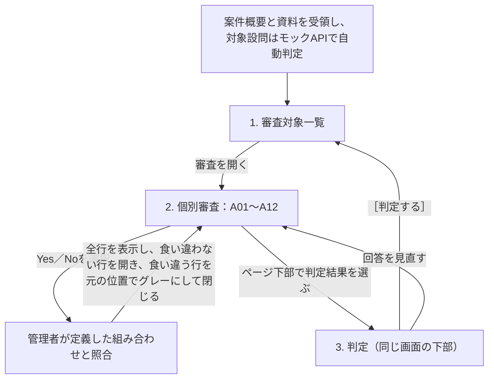

# オペレータ向けワイヤーフロー案

[要件書](requirements.md)の承認済みシナリオ「アカウント・APIの不正利用」と設問A01〜A12を使います。関連データを受け取った案件を一覧に並べ、オペレータがPCで個別に審査し、ページ下部で判定結果を選ぶ画面案です。組み合わせの表示方法と判定結果名はレビュー案です。[判定支援のテーブル案](decision-support-schema.md)に照らして必要なデータを整理します。

## 画面と遷移



### 1. 審査対象一覧

外部から主対象ユーザー（user）と問い合わせ（inquiry）が届き、案件として一覧に表示される想定です。不足するデータは外部APIで補って表示する設計案です。受け取り元、連携方式、補完用APIの接続先、対象を特定する項目はレビューで決めます。画面案では、案件ID、`review_cases.user_data`の主対象ユーザー、審査理由の要約と状態を表に並べます。案件ID・ユーザーID・申告内容で検索でき、状態でも絞り込めます。各行のボタンから個別審査に移ります。

```text
審査対象一覧
CASE-A   user_id 456
心当たりのないログインとクレジット消費    未審査
                                      ［審査を開く］
```

### 2. 個別審査

A01〜A12を左側に1画面で縦に並べ、各設問の横でYes／Noを選びます。全問でYes／Noを選べます。受付時のモックAPIで自動判定済みの設問はYes／Noが入力済みで、残りはオペレータがその場で回答します。試作では全問にその場で答えられる架空案件を使います。まだ選んでいない設問は未回答として数えます。資料・確認欄や確認待ちの操作は画面案には置きません（要件書にある資料不足とNoの区別は、この画面案の変更範囲外です）。

```text
個別審査   CASE-A ／ user_id 456

左：設問A01〜A12（全問Yes／Noを選べる）    右：管理者定義の組み合わせ
A01  ログインは成功したか           ［Yes］ No  自動判定済み   ▾ R01  注意（自動で開く）
A02  本人はログインを否認したか     Yes  No                   ▾ R02  問題なし（自動で開く）
A03  メールアドレスは変更されたか   ［Yes］ No  自動判定済み   ▸ R03  アカウント一時凍結（グレー）
A04  本人はメール変更を否認したか   Yes  No
A05  パスワードは変更されたか       Yes  No
A06  本人はパスワード変更を否認したか Yes  No
A07  クレジットは消費されたか       Yes  No
A08  本人は消費に心当たりがないか   Yes  No
A09  APIキーは新しく発行されたか    Yes  No
A10  本人はキーの発行を否認したか   Yes  No
A11  キーで成功した呼び出しはあるか Yes  No
A12  本人はAPI利用に心当たりがないか Yes  No

↓ ページ下部に判定結果の選択（「3. 判定」を参照）
```

設問の右側に、管理者が事前に定義した組み合わせをアコーディオンで表示します。閉じた行には組み合わせのIDと判定結果名を1行で表示します。初期表示では、入力済みのYes／Noと食い違わない組み合わせの行を自動で開き、食い違ってグレーになった行は閉じます。Yes／Noを実際に選び直したときも同じ規則で開閉を更新します。開いた行だけにA01〜A12の条件を表示します。比較したい行は複数開けます。グレー表示の行も担当者が手で開けます。手動で開閉した状態は回答が変わるまで維持し、［判定する］などの操作では勝手にリセットしません。操作できる画面案では、回答や開いている行を保ったまま、設問側を広く取る列幅と組み合わせ側を広く取る列幅を切り替えられます。

- 入力済みのYes／Noと1問でも食い違う行は、元の位置に残したままグレー表示します。グレーの行にも不一致ラベル・設問ID・理由は添えず、通常行と同じ内容を薄く表示します。回答を選び直すと表示を更新し、食い違いが解消した行は通常表示に戻します。
- 開いた行では、A01〜A12の各条件のうち、すでに入力済みのYes／Noと一致する項目を薄い緑で示します。未回答の設問に対応する条件は緑にしません。緑にするのは右の照合結果側の条件で、左の設問は緑にしません。
- 左の未回答の設問も、照合を絞るのに不要になったものはグレー表示します。グレーでもYes／Noは選べます。どちらか片方の回答で対応する組み合わせが0件になる設問は、照合を絞るのに必要なので通常表示のままにします。画面モックでの必要性判定は、他の未回答に同じ値を入れたとき、当該設問をYesにしてもNoにしても同じ判定結果が残る場合だけ省略（グレー化）できる案です。これは表示上の絞り込みで、下部の判定結果の選択を制限するものではありません。
- 組み合わせが未設定の場合や、全行がグレーになった場合も、グレーを含めた全行を元の位置に表示し続けます。件数や残りの表示を加えるかはレビューで決めます。

12問すべてがYes／Noの完全な組み合わせは2¹²＝4,096通りですが、管理者定義が全4,096通りを網羅するとは限りません。右側は50行ずつページ送りできる案で、食い違う行も元の位置にグレーで残します。全4,096通りを1行ずつ登録した場合、2問の回答が決まった時点で食い違わない組み合わせは1,024通りです。全パターンを登録するか、一部だけ定義するかはレビューで決めます。

下表はグレー表示を確認するための架空ルールです。業務で使う回答と判定結果の対応はレビューで決めます。各列のYはYes、NはNoです。左側でA01とA03がYesの場合、R01とR02は通常表示、R03はA01の値が食い違うためグレーになります（画面にはラベルやIDを出さず、行を薄くするだけです）。

| 行 | 判定結果 | A01〜A06の順 | A07〜A12の順 | 表示 |
| --- | --- | --- | --- | --- |
| R01 | 注意 | Y Y Y Y Y N | Y Y Y N Y Y | 通常 |
| R02 | 問題なし | Y N Y Y Y Y | Y Y Y Y Y N | 通常 |
| R03 | アカウント一時凍結 | N Y Y Y Y N | Y Y Y N Y Y | グレー |

### 3. 判定

個別審査と同じ画面の下部に、判定結果のラジオボタンと［判定する］ボタンを並べる案です（旧案の登録モーダルやSelectは置き換えます）。ラジオボタンは管理者が定義した判定結果の種類で、重い順にアカウント削除、アカウント一時凍結、注意、問題なしを並べます。オペレータの操作を優先し、どのYes／Noを選んでも、未回答が残っていても、照合に食い違わない組み合わせが0件でも、定義済みの全種類の判定結果を選べます。右側のグレー表示は絞り込みの目安で、ここでの選択は制限しません。

```text
個別審査   CASE-A ／ user_id 456 の下部
判定結果（重い順）   ○ アカウント削除   ○ アカウント一時凍結   ○ 注意   ○ 問題なし
                                                         ［判定する］
```

この結果登録は画面上の例です。実際の処置、実API、認定条件は未決で、外部サービスで処置を実行するかどうかも別途決めます。［判定する］を押すと、回答と選んだ結果を1回でまとめて保存します（入力途中の保存はありません）。テーブル案では、`case_results`に選んだ`result_code`を必須で、`rule_id`を任意で保存し、回答は`case_results`の子の`case_checks`に最新の一式として置き換えます。食い違わない組み合わせがなくても結果だけで保存できます。テーブル案の作成タスクの完了はユーザーが承認済みで、一時PGliteでDDL・制約・保存処理案を検証済みです（AWS実環境とアプリは未検証）。この画面レイアウトや業務ルール全体の承認ではありません。

## 架空の1案件でたどる操作

`CASE-A` は「昨夜のログインに心当たりがなく、今朝クレジットが減っていた」という問い合わせの案件です。調査資料にはAPIキーへの言及があります。対象は主対象ユーザー `user_id` 456、A01とA02は同じログイン `LOGIN-1`、A03とA09の対象期間は2026-10-20の09:00〜12:00（日本時間）です。下表は回答の背景となる架空の事実で、画面にはYes／Noだけを表示します。自動判定済みの設問は入力済みで、残りはオペレータがその場で選びます。

| 設問 | 回答の背景となる架空の事実 | 回答と記録例 |
| --- | --- | --- |
| A01 | ログイン履歴 `履歴A1` の「対象ログインの結果」が成功。 | **Yes**。`answer = 'yes'`。 |
| A02 | 本人確認済みの問い合わせ `問い合わせA1` に「自分はログインしていない」と記録。 | **Yes**。 |
| A03 | アカウント変更履歴 `履歴A2` の「登録メールアドレスの変更回数」が1回。 | **Yes**。 |
| A04 | `問い合わせA1` に「自分はメールアドレスを変更していない」と記録。 | **Yes**。 |
| A05 | `履歴A2` の「パスワードの変更回数」が1回。 | **Yes**。 |
| A06 | `問い合わせA1` に「自分がパスワードを変更した」と記録。 | **No**。`answer = 'no'`。 |
| A07 | クレジット利用履歴 `履歴A4` の対象期間の消費量が120クレジット。 | **Yes**。 |
| A08 | `問い合わせA1` に対象のクレジット消費は「心当たりがない」と記録。 | **Yes**。 |
| A09 | 受付時のモックAPIが新規発行の有無にYesを返した例。 | **Yes**。 |
| A10 | `問い合わせA1` に「自分が対象のAPIキーを発行した」と記録。 | **No**。 |
| A11 | API利用履歴 `履歴A5` に対象キーによる呼び出しの成功が3件。 | **Yes**。 |
| A12 | `問い合わせA1` に対象のAPI利用は「心当たりがない」と記録。 | **Yes**。 |

全12問を上表のとおり回答すると、R01は全条件が一致して開き、R02はA02などが食い違うためグレーで閉じます。照合の動きを見るには、A01をYesからNoに選び直します。R01もグレーになって閉じ、A01がNoのR03が通常表示に戻って自動で開きます。開いたR03では、入力済みの回答と一致する条件が薄い緑になります。この架空の回答例に対応する業務上の判定結果は、組み合わせのルールを合意してから設定します。

## 画面とデータ項目の対応

| 画面・部品 | 表示するデータ | 入力・更新するデータ | 表示用に計算する値 |
| --- | --- | --- | --- |
| 審査対象一覧・案件行 | `review_cases.case_id`、`scenario`、`summary`、`case_results`からたどる登録結果。審査状態の詳細は追加候補。 | 対象の受領と案件行の作成は連携案で定義する。［審査を開く］で案件IDを使う。 | `user_data`の主対象ユーザーID。シナリオ名、登録済みかどうかなどの表示ラベル。 |
| 個別審査・設問行 | `review_questions.question_code`、`prompt`、`case_checks.answer`。対象は`review_cases.user_data`の主対象ユーザーと案件の対象期間。問い合わせは`inquiry_data`。 | 案件IDと設問IDの組ごとに`answer`、`answered_by`、`answered_at`を記録する案。自動判定済みは入力済み、残りはオペレータがYes／Noを選ぶ。 | 未回答・Yes・Noの内訳。設問ごとの表示状態（通常／グレー）。 |
| 個別審査・組み合わせ一覧 | 現在のYes／No、ルールの版、組み合わせの行ID、判定結果名（`decision_rules.conditions`と`result_code`）。行を開くとA01〜A12ごとの期待回答を表示し、入力済みの回答と一致する条件を薄い緑で示す。 | 管理者が組み合わせと判定結果の対応を事前に定義する。行の開閉、表示切り替え、ページは画面内で扱う。回答の選択・訂正に応じてグレー表示と自動開閉を更新し、手動の開閉は回答が変わるまで維持する。 | 行ごとの表示状態（通常／グレー）、自動開閉の対象、一致した条件の緑表示、現在のページに表示する行。 |
| 判定・結果選択 | 案件・対象、根拠の回答、定義済みの判定結果の種類（重い順にアカウント削除、アカウント一時凍結、注意、問題なし）。 | `case_results`に案件ID、選んだ`result_code`（必須）、採用ルールID（任意）、登録者、登録日時を、`case_checks`の回答一式とともに［判定する］で一括保存する案。 | 選んだ判定結果と［判定する］の結果。 |

## スキーマの追加・変更候補とレビュー事項

| 画面・操作 | 現行案との照合と追加候補 | 決めたいこと |
| --- | --- | --- |
| データを受け取り、一覧に表示する | 案件の概要と、受け取った主対象のuser・inquiry（`user_data`・`inquiry_data`）を保持して一覧にする。不足情報は外部APIで補って表示する設計案。 | 審査対象の単位、重複受領の扱い、確認行の登録前に表示する対象、受領するデータの形式、回答に必要な根拠がそろわない場合の扱い。 |
| A01〜A12を一覧に表示し、根拠を確認する | 現行案では案件・設問ごとに回答を1件持ち、未回答は`answer IS NULL`で表す。 | A09〜A12を適用する条件、複数のキーを個別に記録する必要があるか、モックAPIを使う設問。 |
| 回答ごとに組み合わせを照合する | `decision_rules`の1行にある`conditions`（設問IDとYes／Noのjsonb）を使う。行ごとのグレー表示は現在の回答から計算する案で、画面にはラベルや設問IDを出さない。 | 組み合わせと判定結果の対応、全12問の条件を必須にするか、例外、食い違わない組み合わせが複数または0件のときの扱い、ルールの適用単位と版の扱い。 |
| 判定結果を保存し、一覧で参照する | `case_results`から案件と判定結果をたどり、`case_checks`は`case_id`で取得する。`rule_id`は任意で、判定結果だけでも保存できる案。 | 保存できる`result_code`の集合と保存側の検査、最終判断者、判定結果名、外部での実行との境界。訂正・履歴と保存期間（入力途中の保存は導入しない）。 |
